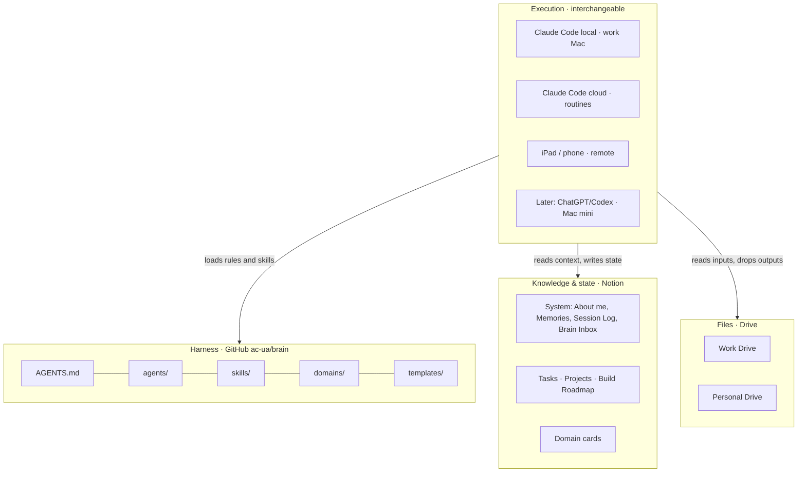
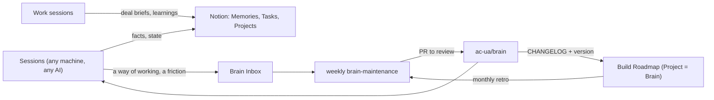

# Blueprint — the brain

Text version of the workspace blueprint (v0.5, 2026-10-27). The illustrated page is published at
https://claude.ai/artifact/Cd9tm1hSrNh5bQ28QT4v3y; its source is `docs/blueprint/workspace-blueprint.html` (French).
To update the page, edit that file and republish it with the Artifact tool, passing the URL above.

## Goal
Organise all of Aurélien's AI work, pro and personal, so that it depends on no machine and no AI.

Success criteria:
- resume work from any device in under 2 minutes, with the right context;
- zero memory that exists only locally;
- session start under budget (~8–10k tokens);
- add a domain in under 15 minutes;
- restore everything in under an hour if the Mac is lost.

## Architecture
Four layers, each replaceable without touching the others. Notion and GitHub are the two sources of truth and don't
overlap: Notion answers *what, and where are we*; GitHub answers *how do we do it*.



Any AI that speaks MCP and reads `AGENTS.md` / `SKILL.md` can take the Execution layer's place.

## Capabilities × domains
- **Rows = agents by capability**, in GitHub, the same everywhere (the builder always applies the same free-tier
  playbook, roadmap and config guide).
- **Columns = domains**, in Notion: a context card, projects and tasks, plus a small `domains/<domain>.md` saying how
  each capability applies there.
- **A cell** = load the agent, its skills and the domain file, nothing else.

Domains: Work, Expeditions, Sport, Content, Admin & Finance, Career, Learning, Life (+ Brain for the brain itself).
Phase 1 agents: chief-of-staff, builder, content-studio. Others (researcher, writer, video studio, analyst, outreach)
appear only when real work asks for them. Work in one session that loads skills; a sub-agent only for heavy,
isolated work, because it costs much more tokens.

## Notion: integrated, not a separate "cloud brain"
```
🏠 Home            cockpit: Today, Inbox, Work / Perso, active projects, latest Brain Inbox
⚙️ System          About me · Memories (+ Domain, Scope) · Session Log · Brain Inbox · Domain template
📋 Tasks           one database: Domain, Context, Owner, Due, Priority, Project
📁 Projects        registry: Domain, Status, Repo, Drive folder, Artifacts, Prod URL
🛠️ Build Roadmap   one database for every build, Project relation, per-project views
💼 Work · 🧭 Expeditions · 🏃 Sport · 🎬 Content · 🗂️ Admin & Finance · 🎯 Career · 🗣️ Learning · 🌍 Life
                   one page per domain: context card on top, Projects/Tasks views, the domain's pages below
🗄️ Archive         old employer (Sprinklr), 2024, empty or superseded pages
```
Free plan: SQL queries capped at ~13/hour, no cross-database joins, 7 days of page history. So: few, wide databases;
agents read through saved views and `fetch`.

**Domain context card** (< 60 lines, the only domain page loaded by default): Purpose · current goals (3 max) · key
facts · rules · where things live · links to the Projects and Tasks views · last update.

## The learning loop

The brain has a version (`v0.x`), a changelog, a Projects row and roadmap items.

## Session lifecycle
1. Read `AGENTS.md` → About me → domain card → project state (Projects, roadmap view, open tasks).
2. Work, loading only the skills needed.
3. Write the deltas: Memories, Tasks, roadmap rows, Brain Inbox.
4. One Session Log row.

Claude's local auto-memory is a scratchpad only: it isn't shared across machines or with the cloud. Skill learnings
live in the skills, so every domain benefits.

## Execution
| | Work Mac (local) | Cloud session | iPad / phone | Mac mini (future) |
|---|---|---|---|---|
| Browser | yes | no | — | yes |
| Push to `ac-ua/*` | **no** (corporate proxy) | yes | via cloud | yes |
| claude.ai connectors | yes | yes | yes | yes |
| Scheduled routines | Mac must be on | yes (≥ 1 h interval) | — | always on |

Routing: browser or pro files → local on the work Mac; personal code, harness, routines → cloud; drive both from the
iPad. Cloud environments: `perso-general` (default), `app-element`, `app-base-camp`; none per domain.

## Files
The Drive is the source of files; local disks are a throwaway cache. Work and personal Drives stay apart.
Work Drive layout and filing rules: `docs/drive-map.md`.
Pro context and learnings go to Aurélien's Notion (his work system of record too). Forbidden: personal → pro systems.
Pro → personal is allowed (2026-10-29): the work Mac writes to the personal Drive through the Google Drive app.
Large media is processed in the cloud or on a future personal machine, never on the work Mac.

## Decisions (2026-10-27)
1. Notion = knowledge and state; `ac-ua/brain` = harness; any AI executes. Open formats: AGENTS.md, SKILL.md, MCP.
2. Capability × domain model; 3 agents in phase 1, built from existing know-how.
3. System section + Home, Tasks, Projects, Build Roadmap integrated into the existing Notion; one page per domain at migration.
4. Facts → Notion now. Ways of working → Brain Inbox → weekly PR.
5. One shared Build Roadmap with per-project views. A project shared outside, or with specific fields, gets its own
   database from the same template (`templates/notion/`).
6. Notion backup: a manual native export once a month (Markdown + CSV) to the personal Drive. No script for now.
7. Pro work local on the work Mac; personal work in the cloud. The work Mac cannot push to `ac-ua/*`, and we don't work
   around it. Writing to the personal Drive from the cloud: rclone in `perso-general` (to test).
8. Cloud environments per app with its own secrets, plus `perso-general`.
9. Claude Code is the main workshop; claude.ai Projects and Cowork stay for quick chats; their content migrates when
   the domain is touched.
10. Autonomy: no external send, publishing or payment without Aurélien; every deletion needs his approval; drafts,
    Notion and commits are free. Can be relaxed later, domain by domain.
11. Notion is the system of record for work too (revised 2026-10-27): every work session writes its deal brief and
    learnings to Notion; pro files live in the work Drive.
    Monthly copy of the work plugin: decided, with a flagged IP risk (rewriting generic methods is the safer path).
12. Voice clone: only on explicit request; nothing about it in this repo. Stock voice by default.
13. Confidentiality is one way (2026-10-29): personal → pro is forbidden; pro → personal is allowed. Deliverables
    come back from the work Mac to the personal Drive through the Google Drive app.
13. Content: short-form first (TikTok, Instagram), published by hand at first; strategy is content-studio's first job.
14. Secrets: the password manager is the single source. Never in Notion, GitHub or a memory.
15. Strava only via its official connector; intervals.icu is the AI-agnostic path. OpenClaw set aside (security,
    always-on host). No always-on orchestrator: chief-of-staff runs from scheduled cloud routines.
16. Editing: free DaVinci Resolve has no scripting API, but imports FCPXML/OTIO, so the AI makes a rough cut and
    Aurélien finishes it. Resolve Studio later if volume justifies it.

## Migration plan
| Phase | Content | State |
|---|---|---|
| P0 | Secure: credentials out of Notion; 44 local memories into the Migration inbox; free-tier playbook saved | done |
| P1 | Skeleton (`v0.1.0`): this repo; Notion System, Home, Tasks, Projects, Build Roadmap, Domain template | done (PR) |
| P1 bis | "Mac lost" drill: resume a real task from the iPad and a cloud session only; measure the start budget | to do |
| Rolling | Each session migrates the domain it touches: read its old memories, write its card, tick it in the roadmap. Expeditions + Content first, then Sport, Learning, Career, Admin, Work | to do |
| Routines | morning brief; weekly brain-maintenance; pro learnings every 2 weeks; monthly plugin copy, retro, export reminder, artifact source backup. All routines: [`routines.md`](routines.md) | idea |
| Later | Mac mini (video, local models), Resolve Studio, Finance domain, cockpit app, publishing tools | idea |

## Backlog
Tracked in the Build Roadmap (Project = Brain): "Mac lost" drill · rclone in `perso-general` · multi-account mail test
(4 mailboxes; candidate: an open-source multi-account Google MCP + an Outlook connector) · Expeditions + Content
migration · explainer video / podcast skill (`skills/explainer-video/`) · weekly brain-maintenance · pro → perso
learnings · monthly plugin copy · morning brief · intervals.icu + Strava · Mac mini · Resolve Studio · Finance domain ·
cockpit app (study and design proposals: https://claude.ai/artifact/4xqmHuenUqj4EUZ292uoWF, source
`docs/cockpit/cockpit-proposals.html`).

## Open questions
- Mac mini: whether and when. It decides when the video pipeline and local models start.
- Element Logbook Notion page: move its publishable identifiers into the repo docs during the Sport migration.
